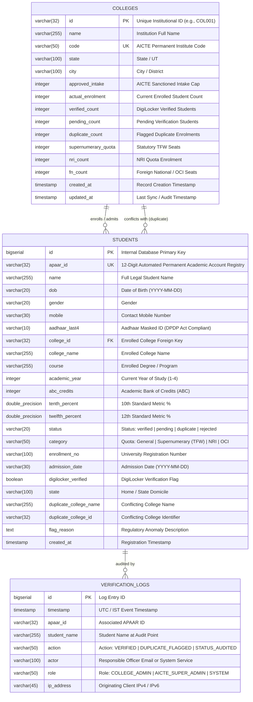
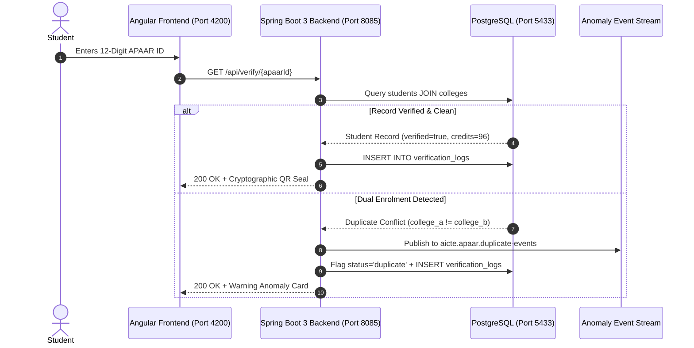

# 🏛️ Database Architecture & Schema Design Specification
**Platform:** AICTE APAAR ID-Based Student Data Management & Verification Platform  
**Problem Statement ID:** SIH-26263  
**Database Engine:** PostgreSQL 16+ (Local Instance: `localhost:5433`, Database: `apaardb`)  
**ORM / Data Layer:** Spring Boot 3 + Spring Data JPA (Hibernate 6)  
**Standard Standards:** National Education Policy (NEP 2020), AICTE Approval Process Handbook (APH 2026-27), DPDP Act 2023  

---

## 1. 📐 Entity-Relationship (ER) Diagram



---

## 2. 🗄️ Relational Schema Breakdown

### 2.1 Table: `colleges`
Stores AICTE-approved higher educational institutions, sanctioned intake capacities, and live enrolment metrics.

| Column | Data Type | Constraints | Description |
| :--- | :--- | :--- | :--- |
| `id` | `VARCHAR(32)` | `PRIMARY KEY` | Institution code (e.g., `COL001`). |
| `name` | `VARCHAR(255)` | `NOT NULL` | Registered institutional title. |
| `code` | `VARCHAR(50)` | `NOT NULL, UNIQUE` | Official AICTE Code (e.g., `AICTE-DL-0012`). |
| `state` | `VARCHAR(100)` | `NOT NULL` | Jurisdiction state. |
| `city` | `VARCHAR(100)` | `NOT NULL` | City campus location. |
| `approved_intake` | `INTEGER` | `DEFAULT 0` | Regulatory ceiling sanctioned by AICTE. |
| `actual_enrolment` | `INTEGER` | `DEFAULT 0` | Total enrolled students for the current AY. |
| `verified_count` | `INTEGER` | `DEFAULT 0` | Verified student count. |
| `pending_count` | `INTEGER` | `DEFAULT 0` | Awaiting identity confirmation. |
| `duplicate_count` | `INTEGER` | `DEFAULT 0` | Flagged dual-enrolment conflicts. |
| `supernumerary_quota`| `INTEGER` | `DEFAULT 0` | Tuition Fee Waiver (TFW) allocated seats. |
| `nri_count` | `INTEGER` | `DEFAULT 0` | Non-Resident Indian quota admissions. |
| `fn_count` | `INTEGER` | `DEFAULT 0` | Foreign National / OCI admissions. |
| `created_at` | `TIMESTAMP` | `DEFAULT CURRENT_TIMESTAMP` | Row creation timestamp. |
| `updated_at` | `TIMESTAMP` | `DEFAULT CURRENT_TIMESTAMP` | Last updated timestamp. |

---

### 2.2 Table: `students`
National academic repository linking student identities to their 12-digit APAAR ID and institutional enrolment.

| Column | Data Type | Constraints | Description |
| :--- | :--- | :--- | :--- |
| `id` | `BIGSERIAL` | `PRIMARY KEY` | Auto-incrementing primary key. |
| `apaar_id` | `VARCHAR(32)` | `NOT NULL, UNIQUE` | 12-digit permanent academic registry ID. |
| `name` | `VARCHAR(255)` | `NOT NULL` | Full name as per Aadhaar / NAD records. |
| `dob` | `VARCHAR(20)` | `NOT NULL` | Date of Birth. |
| `gender` | `VARCHAR(20)` | `NOT NULL` | Gender identity. |
| `mobile` | `VARCHAR(30)` | - | DPDP-compliant contact phone. |
| `aadhaar_last4` | `VARCHAR(10)` | - | Masked UIDAI 4-digit token. |
| `college_id` | `VARCHAR(32)` | `REFERENCES colleges(id)` | Foreign key to primary college. |
| `college_name` | `VARCHAR(255)`| - | Institution name snapshot. |
| `course` | `VARCHAR(255)`| `NOT NULL` | Program (e.g., *B.Tech Computer Science*). |
| `academic_year` | `INTEGER` | `DEFAULT 1` | Academic year (1 through 4). |
| `abc_credits` | `INTEGER` | `DEFAULT 0` | NEP 2020 Academic Bank of Credits balance. |
| `tenth_percent` | `DOUBLE PRECISION`| - | Secondary school percentage. |
| `twelfth_percent`| `DOUBLE PRECISION`| - | Higher secondary percentage. |
| `status` | `VARCHAR(20)` | `DEFAULT 'pending'` | `verified`, `pending`, `duplicate`, `rejected`. |
| `category` | `VARCHAR(50)` | `DEFAULT 'General'` | `General`, `Supernumerary (TFW)`, `NRI`. |
| `enrollment_no` | `VARCHAR(100)`| - | Institutional roll / registration number. |
| `admission_date` | `VARCHAR(30)` | - | Formal enrolment date. |
| `digilocker_verified`| `BOOLEAN` | `DEFAULT FALSE` | True if verified against DigiLocker gateway. |
| `state` | `VARCHAR(100)`| `NOT NULL` | Student domicile state. |
| `duplicate_college_name`| `VARCHAR(255)`| - | Conflicting institutional entity. |
| `duplicate_college_id` | `VARCHAR(32)` | - | Conflicting institution identifier. |
| `flag_reason` | `TEXT` | - | Automated regulatory rule trigger explanation. |
| `created_at` | `TIMESTAMP` | `DEFAULT CURRENT_TIMESTAMP` | Registration timestamp. |

---

### 2.3 Table: `verification_logs`
Provides an immutable, tamper-evident audit ledger mandated by statutory e-governance guidelines.

| Column | Data Type | Constraints | Description |
| :--- | :--- | :--- | :--- |
| `id` | `BIGSERIAL` | `PRIMARY KEY` | Sequence log identifier. |
| `timestamp` | `TIMESTAMP` | `DEFAULT CURRENT_TIMESTAMP` | Event timestamp. |
| `apaar_id` | `VARCHAR(32)` | `NOT NULL` | Target student APAAR ID. |
| `student_name` | `VARCHAR(255)`| `NOT NULL` | Student name at audit point. |
| `action` | `VARCHAR(50)` | `NOT NULL` | Executed operation (`VERIFIED`, `DUPLICATE_FLAGGED`, etc.). |
| `actor` | `VARCHAR(100)`| `NOT NULL` | Email of operator or automated risk daemon. |
| `role` | `VARCHAR(50)` | `NOT NULL` | Authority level (`COLLEGE_ADMIN`, `AICTE_SUPER_ADMIN`). |
| `ip_address` | `VARCHAR(45)` | - | IPv4 / IPv6 audit trail address. |

---

## 3. ⚡ Indexing & Performance Optimizations

```sql
-- Fast student lookup by unique national APAAR ID
CREATE INDEX idx_students_apaar_id ON students(apaar_id);

-- Institutional filtering & aggregation acceleration
CREATE INDEX idx_students_college_id ON students(college_id);

-- Status filtering for dashboard queues (pending/duplicate/verified)
CREATE INDEX idx_students_status ON students(status);

-- State-level statistical reporting
CREATE INDEX idx_students_state ON students(state);
CREATE INDEX idx_colleges_state ON colleges(state);

-- Fast chronologically sorted statutory audit queries
CREATE INDEX idx_verification_logs_timestamp ON verification_logs(timestamp DESC);
```

---

## 4. 📊 Regulatory Analytical Views

### 4.1 Intake Compliance & Over-Enrolment Audit: `v_college_intake_compliance`
Automatically detects whether an institution has breached its approved intake cap:
```sql
CREATE VIEW v_college_intake_compliance AS
SELECT 
    c.id AS college_id,
    c.name AS college_name,
    c.code AS aicte_code,
    c.state,
    c.approved_intake,
    c.actual_enrolment,
    (c.actual_enrolment - c.approved_intake) AS intake_variance,
    CASE 
        WHEN c.actual_enrolment > c.approved_intake THEN 'OVER_INTAKE_VIOLATION'
        WHEN c.actual_enrolment = c.approved_intake THEN 'CAPACITY_REACHED'
        ELSE 'WITHIN_SANCTIONED_LIMIT'
    END AS compliance_status,
    c.supernumerary_quota AS tfw_quota,
    c.nri_count,
    c.fn_count,
    c.verified_count,
    c.pending_count,
    c.duplicate_count
FROM colleges c;
```

### 4.2 Cross-Institution Duplicate Monitor: `v_duplicate_enrolment_conflicts`
Surfaces students holding simultaneous active seats across institutional or state borders:
```sql
CREATE VIEW v_duplicate_enrolment_conflicts AS
SELECT 
    s.apaar_id,
    s.name AS student_name,
    s.college_id AS primary_college_id,
    s.college_name AS primary_college_name,
    s.duplicate_college_id AS conflicting_college_id,
    s.duplicate_college_name AS conflicting_college_name,
    s.course,
    s.state AS home_state,
    s.flag_reason,
    s.created_at
FROM students s
WHERE s.status = 'duplicate';
```

---

## 5. 🔄 Verification & Data Flow Lifecycle



---

## 6. 🛠️ Maintenance & CLI Operations

- **Full SQL Dataset File:** `database/apaar_postgres_dataset.sql`
- **Re-import Dataset via psql:**
  ```powershell
  psql -h localhost -p 5433 -U postgres -d apaardb -f database/apaar_postgres_dataset.sql
  ```
- **Run Backend from Source (Without .jar):**
  ```powershell
  npm run backend
  # or directly in backend directory:
  .\mvnw.cmd spring-boot:run
  ```

